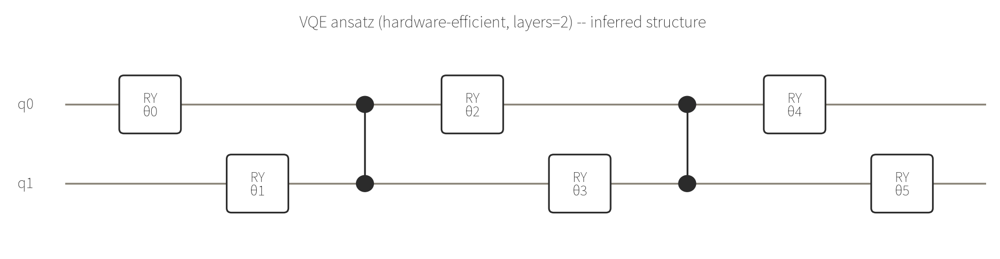

# 例5: VQEで横磁場イジング模型の基底エネルギーを求める

> 動きで見る: [quantum-visualizer でこの例のふるまいを見る](https://wanyaldee.github.io/quantum-visualizer/#vqe/ising)
> つまみ（RY の角度）を1ステップずつ回して、エネルギーが −√5 へ下がっていく様子を見られます。

`run_vqe` はハミルトニアンを与えると、ハードウェア効率的アンザッツ（RY回転 + CZチェーン）を使った
変分量子固有値ソルバー(VQE)で基底状態エネルギーを近似計算してくれます。

## はじめに: VQE は何をしているのか（数式なし）

VQE（変分量子固有値ソルバー）は、**量子コンピュータと普通のコンピュータが交代で働いて、一番低いエネルギーを探す方法**です。

1. **量子コンピュータが状態を作って測る。** つまみ（回路の中の回転ゲートの角度）付きの回路で状態を作り、
   何回も測った平均（期待値）からエネルギーを出します。
2. **普通のコンピュータがつまみを回す。** つまみを少し回したときにエネルギーが上がるか下がるか（坂の向き＝勾配）を調べ、
   下がる向きにつまみを回します。
3. これをくり返して、エネルギーが下がらなくなったら終わりです。

大事な性質が1つあります（**変分原理**）。どんな状態のエネルギーを測っても、**本当の一番低いエネルギーより下にはなりません**。
だから、測ったエネルギーが低ければ低いほど、本当の答えに近いと言えます。

この例の答え **−√5（約 −2.236）** は、2量子ビットなら手計算でも求められる「答え合わせ用の値」です。
VQE の結果がこの値に届けば、正しく動いていると確かめられます。

| 言葉 | ひとことで言うと |
|---|---|
| ハミルトニアン | 状態ごとのエネルギーを決める式。 |
| パラメータ（つまみ） | 回路の中の回転ゲートの角度。ラジオのつまみのように回して、作る状態を少しずつ変えます。 |
| アンザッツ（試しの回路の形） | つまみ付きの回路の「形」。この形で答えの状態が作れないと、どれだけつまみを回しても届きません。 |
| 期待値 | 何回も測ったときの平均。エネルギーは何回も測った平均で決めます。 |
| 局所解（くぼみ） | まわりのどこよりも低いのに、一番低い所ではない場所。ここに入ると最適化が止まります。 |

### 独立した再現

[quantum-visualizer](https://wanyaldee.github.io/quantum-visualizer/#vqe/ising) で、下の「逆算した回路」と同じ形
（RY 層と CZ を交互に、つまみ6個）を、パラメータシフト則で求めた勾配を使って最適化し直しました。
エネルギーは −√5 に届き、到達した状態の確率（`01`・`10` が 0.361804、`00`・`11` が 0.138196）は
下の `top_states` と4桁まで一致しました。

ただし、**届く割合は、つまみを一度にどれだけ回すか（学習率＝一歩の大きさ）しだいで変わります。**
初期値を −π〜π からランダムに40通り選び、誤差 1e-4 以内で −√5 に届いた数を数えました
（乱数の作り方が違うので、件数がぴったり合わないのは自然です）。

| 学習率 | ステップ数 | quantum-visualizer | このリポジトリで独立に再計算 |
|---:|---:|---:|---:|
| 0.2（visualizer の設定） | 60 | 40 / 40 | 40 / 40 |
| 0.2 | 1000 | 40 / 40 | 40 / 40 |
| 0.5 | 1000 | 29 / 40 | 31 / 40 |

学習率 0.5 で届かなかった出発点は、−1.85〜−2.23 あたりで下がり方がとても遅くなっていました
（こちらでは 20000 ステップまで続けると 39 / 40 が届き、残る1つは −1.97 付近でまだ下がっている途中でした）。
同じ回路・同じ問題でも、一歩の大きさを変えるだけで結果が変わる、ということです。

`run_vqe` の中の最適化方法は公開されていないので、ステップ数は `run_vqe` とは比べられません。

## ハミルトニアン

2量子ビットの横磁場イジング模型:

$$
H = Z_0 Z_1 - X_0 - X_1
$$

```json
{
  "n_qubits": 2,
  "hamiltonian": [
    {"coeff": 1,  "paulis": [{"op": "Z", "qubit": 0}, {"op": "Z", "qubit": 1}]},
    {"coeff": -1, "paulis": [{"op": "X", "qubit": 0}]},
    {"coeff": -1, "paulis": [{"op": "X", "qubit": 1}]}
  ],
  "layers": 2
}
```

- `layers`: アンザッツの深さ。free tierの上限はQAOAと同じ枠（2）。

`run_vqe` の説明には「RY回転 + CZチェーンを層ごとに繰り返すハードウェア効率的アンザッツ」としか書かれておらず、
正確な回路構造は非公開ですが、`optimized_params` が6要素（`layers=2, n_qubits=2`）返ってきたことから
「RY層×3（各層2量子ビット分）とCZ層×2が交互に並ぶ」構造だと逆算できます（下図は検証目的の推定構造）。



## 結果

```json
{
  "energy": -2.236067977499361,
  "top_states": [
    {"bitstring": "01", "probability": 0.361804},
    {"bitstring": "10", "probability": 0.361803},
    {"bitstring": "11", "probability": 0.138197},
    {"bitstring": "00", "probability": 0.138196}
  ]
}
```

`-2.236067977499361` は $-\sqrt{5}$ に一致します。この2量子ビット横磁場イジング模型は手計算でも対角化でき、
最小固有値は解析的に $-\sqrt{5} \approx -2.2360679\ldots$ になるので、VQEが正しく基底エネルギーへ収束していることが
検証できます。基底状態は $|01\rangle$ と $|10\rangle$ の重ね合わせが支配的で、 $Z_0 Z_1$ 項（反強磁性的に揃えたい）と
横磁場項 $X_0, X_1$（量子ゆらぎ）がせめぎ合った結果になっています。

`proof`: [✓ 実行済み sim_20260827_5b2508e08ca8da5d](https://mcp.blueqat.app/runs/sim_20260827_5b2508e08ca8da5d)

## QAOAとの使い分け

- 組み合わせ最適化（QUBO、0/1変数）を解きたい → `run_qaoa`
- 一般のパウリハミルトニアンの基底エネルギーを求めたい（分子のエネルギーなど）→ `run_vqe`

と`sdk_info`のツール説明にある通り、QUBO専用の問題では`run_qaoa`の方が素直に定式化できます。
