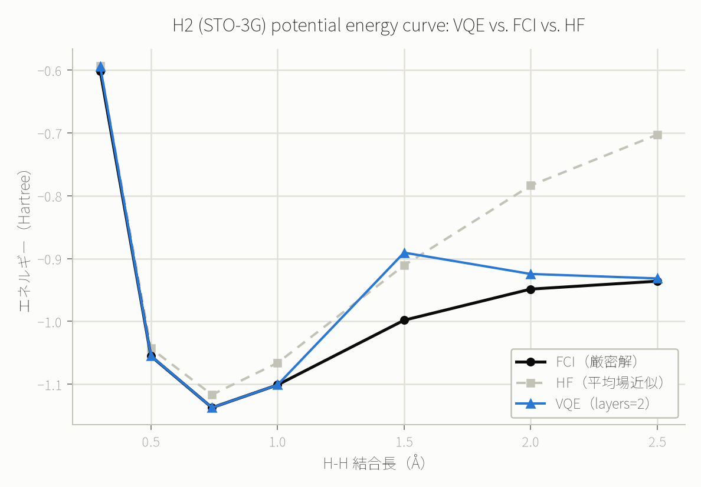

# 例12: VQEで水素分子（H2）の基底エネルギーを求める — 量子化学の入り口

> 動きで見る: [quantum-visualizer でこの例のふるまいを見る](https://wanyaldee.github.io/quantum-visualizer/#vqe/h2)
> 7つの結合長を切り替えて、つまみを回してエネルギーが下がる様子と、FCI・HF・`run_vqe` の結果を並べた曲線を見られます。

[例5](05_vqe_transverse_ising.md)のVQEはイジング模型という物理の教科書的な模型でしたが、ここでは
実在の分子（水素分子、H2）の電子構造計算に同じ仕組みを使います。PySCFとOpenFermionで実際の
量子化学計算を行い、Jordan-Wigner変換で得た4量子ビットのハミルトニアンを `run_vqe` に渡し、
古典的な厳密解（FCI）・平均場近似（HF）と正面から比較します。

## はじめに: この例に出てくる言葉

| 言葉 | ひとことで言うと |
|---|---|
| 基底エネルギー | 分子が一番落ち着いた状態のエネルギー。これが分かると、分子の形や結びつきの強さが分かります。 |
| 結合長 | 2つの水素原子の間の距離。距離を変えながらエネルギーを測ると、どの距離で一番安定するかが分かります。 |
| HF（平均場近似） | 電子1つ1つが「ほかの電子の平均的な影響」だけを感じると考える近似。電子どうしがよけ合う効果を取りこぼすので、本当の値より少し高くなります。 |
| FCI（厳密解） | 近似をせず、すべての可能性を調べて求めた本当の答え。水素分子くらい小さければ普通のコンピュータで計算できるので、VQE の答え合わせに使います。 |
| 局所解（くぼみ） | まわりのどこよりも低いのに、一番低い所ではない場所。VQE の最適化がここに入ると、そこから抜け出せずに止まります。 |
| 化学的精度 | 化学の予測に役立つと言える誤差の目安。約 0.0016 Hartree（1 kcal/mol）です。これより誤差が大きいと、反応の起きやすさなどを正しく予測できません。 |

VQE そのものの言葉（つまみ・アンザッツ・変分原理など）は [docs/basics.md](../docs/basics.md) と
[例5](05_vqe_transverse_ising.md) を参照してください。

## 分子からハミルトニアンへ

H2分子をSTO-3G基底（最小基底、量子化学の教科書で最初に使われる基底系）で扱うと、Jordan-Wigner
変換後にちょうど**4量子ビット・14項**のハミルトニアンになり、free tierの上限（10量子ビット、
ハミルトニアン最大20項）に余裕を持って収まります。

再現用スクリプト: [scripts/build_h2_vqe.py](../scripts/build_h2_vqe.py)
（`uv run --with pyscf --with openfermion --with openfermionpyscf python3 scripts/build_h2_vqe.py`）

結合長 0.7414 Å（実験的な平衡結合長）でのハミルトニアン（14項）:

```json
[
  {"coeff": 0.17119775, "paulis": [{"op": "Z", "qubit": 0}]},
  {"coeff": 0.17119775, "paulis": [{"op": "Z", "qubit": 1}]},
  {"coeff": -0.22278593, "paulis": [{"op": "Z", "qubit": 2}]},
  {"coeff": -0.22278593, "paulis": [{"op": "Z", "qubit": 3}]},
  {"coeff": 0.16862219, "paulis": [{"op": "Z", "qubit": 0}, {"op": "Z", "qubit": 1}]},
  {"coeff": 0.0453222, "paulis": [{"op": "Y", "qubit": 0}, {"op": "X", "qubit": 1}, {"op": "X", "qubit": 2}, {"op": "Y", "qubit": 3}]},
  {"coeff": -0.0453222, "paulis": [{"op": "Y", "qubit": 0}, {"op": "Y", "qubit": 1}, {"op": "X", "qubit": 2}, {"op": "X", "qubit": 3}]},
  {"coeff": -0.0453222, "paulis": [{"op": "X", "qubit": 0}, {"op": "X", "qubit": 1}, {"op": "Y", "qubit": 2}, {"op": "Y", "qubit": 3}]},
  {"coeff": 0.0453222, "paulis": [{"op": "X", "qubit": 0}, {"op": "Y", "qubit": 1}, {"op": "Y", "qubit": 2}, {"op": "X", "qubit": 3}]},
  {"coeff": 0.12054482, "paulis": [{"op": "Z", "qubit": 0}, {"op": "Z", "qubit": 2}]},
  {"coeff": 0.16586702, "paulis": [{"op": "Z", "qubit": 0}, {"op": "Z", "qubit": 3}]},
  {"coeff": 0.16586702, "paulis": [{"op": "Z", "qubit": 1}, {"op": "Z", "qubit": 2}]},
  {"coeff": 0.12054482, "paulis": [{"op": "Z", "qubit": 1}, {"op": "Z", "qubit": 3}]},
  {"coeff": 0.17434844, "paulis": [{"op": "Z", "qubit": 2}, {"op": "Z", "qubit": 3}]}
]
```

核間反発を含む定数項（-0.098864 Hartree）はこのハミルトニアンに含まれていません。`run_vqe` が
返す電子エネルギーにこの定数を後から足すことで、分子の全エネルギーになります（量子化学計算では
標準的な扱いです）。

**7つの結合長すべてのハミルトニアン**（14項の係数・定数項・HF・FCI）は
[assets/12_h2_hamiltonians.json](../assets/12_h2_hamiltonians.json) に置いてあります。
`scripts/build_h2_vqe.py --json assets/12_h2_hamiltonians.json` で生成したもので、各結合長について
「ハミルトニアン行列の一番小さい固有値 + 定数 = FCI」「状態 `1100` のエネルギー + 定数 = HF」になることを
numpy で確かめています（下の表の HF・FCI と6桁まで一致）。

## 結果: ポテンシャルエネルギー曲線（7点、layers=2）



| 結合長(Å) | HF | FCI（厳密解） | VQE（全エネルギー） | VQE−FCI |
|---:|---:|---:|---:|---:|
| 0.30 | -0.593828 | -0.601804 | -0.594490 | +0.007314 |
| 0.50 | -1.042996 | -1.055160 | -1.054792 | +0.000368 |
| **0.7414（平衡）** | -1.116684 | -1.137270 | **-1.137270** | **+0.000000** |
| 1.00 | -1.066109 | -1.101150 | -1.101146 | +0.000004 |
| 1.50 | -0.910874 | -0.998149 | -0.890585 | **+0.107564** |
| 2.00 | -0.783793 | -0.948641 | -0.924536 | +0.024105 |
| 2.50 | -0.702944 | -0.936055 | -0.931634 | +0.004421 |

（エネルギー単位はHartree。「化学的精度」の目安は誤差0.0016 Hartree程度とされます。）

`proof`（結合長順）:
- 0.3Å: [✓ sim_20260828_d3757eee96d5a82a](https://mcp.blueqat.app/runs/sim_20260828_d3757eee96d5a82a)
- 0.5Å: [✓ sim_20260828_9512e46d26832e2d](https://mcp.blueqat.app/runs/sim_20260828_9512e46d26832e2d)
- 0.7414Å: [✓ sim_20260828_9006e43fdd3d5b3c](https://mcp.blueqat.app/runs/sim_20260828_9006e43fdd3d5b3c)
- 1.0Å: [✓ sim_20260828_e8e9a237b066451f](https://mcp.blueqat.app/runs/sim_20260828_e8e9a237b066451f)
- 1.5Å: [✓ sim_20260828_9f56ec5b978b6306](https://mcp.blueqat.app/runs/sim_20260828_9f56ec5b978b6306)
- 2.0Å: [✓ sim_20260828_b115b324122b8476](https://mcp.blueqat.app/runs/sim_20260828_b115b324122b8476)
- 2.5Å: [✓ sim_20260828_cf910ed98426ccea](https://mcp.blueqat.app/runs/sim_20260828_cf910ed98426ccea)

## 平衡結合長ではFCIと完全一致、しかし1.5Åでは大きく外れた

**平衡結合長（0.7414Å）と1.0Åでは、VQEはFCI（厳密解）と小数点以下6桁まで一致しました。** H2の
STO-3G基底は電子2個・4量子ビットという最小規模のため、`layers=2`のhardware-efficientアンザッツ
（RY回転+CZ鎖）でも表現力が十分だったと考えられます。

**一方、結合長1.5Åでは誤差が+0.107564 Hartreeと突出して大きくなりました。** これは化学的精度
（0.0016 Hartree）を50倍以上超えています。原因を`top_states`で確認すると、他の結合長では
主に `1100`/`0011` の重ね合わせに収束しているのに対し、1.5Åでは `0101`（35.1%）・`0110`（24.1%）・
`1001`（24.1%）・`1010`（16.6%）という全く異なる4状態に分散した解に収束していました
（[optimized_paramsの実際の値](https://mcp.blueqat.app/runs/sim_20260828_9f56ec5b978b6306)も
他の結合長と質的に異なるパターンです）。これはVQEの古典最適化が**局所解に捕まった**典型例と
考えられます（VQEでは初期パラメータや損失地形（バレンプラトー等）によって最適化が本当の基底状態に
到達しない、という既知の課題です）。

### 補足: 平衡結合長でも、出発点によっては HF で止まる

[quantum-visualizer](https://wanyaldee.github.io/quantum-visualizer/#vqe/h2) で、同じ形の回路
（RY 層と CZ チェーンを交互に、`layers=2`、つまみ12個）を 0.7414 Å で最適化し直したところ、
つまみの初期値によっては **HF のエネルギー（−1.116684）ちょうどで止まる**ことがありました。
止まったときの状態は `1100`（HF 状態）が 100% です。

| 試した人 | 初期値の数 | FCI に化学的精度で届いた | HF で止まった | その他 |
|---|---:|---:|---:|---:|
| quantum-visualizer | 12 | 7 | 4 | 1（−1.1248 でまだゆっくり下がっていた） |
| このリポジトリで独立に再計算 | 40 | 33 | 5 | 2（−1.117262, −1.132183） |

条件はどちらも、初期値を −π〜π からランダムに選び、パラメータシフト則で勾配を求めて
学習率 0.5 で1000ステップ下る、です（乱数が違うので内訳は一致しません）。
つまり、上の表で 1.5 Å だけ外れたのと同じ「最適化が途中で止まる」ことは、平衡結合長でも起こりえます。
止まった点で数値的に調べると、坂の傾き（勾配）はちょうどゼロで、まわりは平らか上り坂でした。
勾配だけを見て下る方法は、ここで動けなくなります。

### 補足: 1.5・2.0・2.5 Å の外れ方は、別の最適化でも同じ値で再現した

上の表で `run_vqe` が FCI から外れた 1.5・2.0・2.5 Å について、同じ形の回路（RY 層と CZ チェーン、`layers=2`）を
別の方法（パラメータシフト則＋勾配降下、学習率 0.5、1000ステップ、初期値は −π〜π からランダム）で最適化し直しました。
すると、**`run_vqe` が出した値とほとんど同じ値で止まる出発点がたくさんありました。**
ハミルトニアンは [assets/12_h2_hamiltonians.json](../assets/12_h2_hamiltonians.json) を使っています。

| 結合長 | FCI | HF | `run_vqe` | quantum-visualizer（4つの出発点） | このリポジトリで再計算（20の出発点） |
|---|---:|---:|---:|---|---|
| 0.30 Å | −0.601804 | −0.593828 | −0.594490 | `run_vqe` の値で止まったもの 0 | `run_vqe` の値で止まったもの 0（一番近いのは −0.594600） |
| 1.50 Å | −0.998149 | −0.910874 | −0.890585 | 2つが −0.890581・−0.890585 で止まった | 12が −0.890585 の前後 1e-4 以内で止まった（FCI に届いたのは7） |
| 2.00 Å | −0.948641 | −0.783793 | −0.924536 | 2つが −0.924537 で止まった | 19が −0.924537 前後で止まった（FCI に届いたのは1） |
| 2.50 Å | −0.936055 | −0.702944 | −0.931634 | 2つが −0.931634・−0.931639 で止まった | 19が −0.931639 前後で止まった（FCI に届いたのは1） |

分かったこと:

- **最適化の方法が違っても、同じ回路の形には同じ「止まる場所（くぼみ）」があり、`run_vqe` もそこで止まっていた**と考えられます。
  上で「1.5Å は局所解に捕まった典型例と考えられる」と書いた推測を裏づける結果です。
- **1.5 Å で止まる値（−0.890585）は、HF（−0.910874）よりも高い**です。最適化した結果が、平均場近似より悪くなることがあります。
- 2.0・2.5 Å では、こちらの再計算で20中19の出発点が同じ値で止まりました。距離が離れるほど、この回路では FCI に届きにくくなっています。
- **0.30 Å の `run_vqe` の値（−0.594490）は、どちらでも再現できませんでした。** 出発点の数が限られているので、
  「そこに止まる場所がない」とまでは言えません。
- 1.0 Å では、こちらの再計算で20中4の出発点（visualizer では40中4）が −0.745872 で止まりました。
  これは HF（−1.066109）よりずっと高い値です。正体は次の節で説明します。

### 補足: 止まった先は「三重項」だった

**数式なしで言うと:** 電子は、小さな磁石のような性質（**スピン**）を持っています。水素分子の本当の答え（一番低いエネルギー）では、
2つの電子が**逆向き**でペアになっています（一重項）。ところが `run_vqe` は 1.5・2.0・2.5 Å で、2つの電子の向きが**そろった**
別の状態（**三重項**）に落ち着いていました。三重項は、本当の答えより少しエネルギーが高い「**励起状態**」の1つです。

確かめ方は次のとおりです。[assets/12_h2_hamiltonians.json](../assets/12_h2_hamiltonians.json) のハミルトニアンの全準位を numpy で求め、
OpenFermion の `s_squared_operator`（スピンの大きさを測る演算子）を同じ並びの量子ビットに変換して当てました。

| 結合長 | 一番低い準位（本当の答え） | 三重項の準位（3つの状態が同じエネルギー） | `run_vqe` | `run_vqe` − 三重項 |
|---|---:|---:|---:|---:|
| 1.00 Å | −1.101150 | −0.745872 | −1.101146（本当の答えに届いた） | — |
| 1.50 Å | −0.998149 | −0.890585 | −0.890585 | −2e-7 |
| 2.00 Å | −0.948641 | −0.924537 | −0.924536 | +1e-6 |
| 2.50 Å | −0.936055 | −0.931639 | −0.931634 | +5e-6 |

- 本当の答えはどの結合長でもスピンの大きさが 0（一重項）、三重項の準位の3つの状態はどれも
  S(S+1) = 2、つまり S = 1 でした。
- 量子ビットの並びは OpenFermion の標準（偶数番がスピン上向き、奇数番が下向き）です。`1010` は2つの電子が両方とも上向き、
  `0101` は両方とも下向きの状態で、どちらも三重項のエネルギーとぴったり一致しました。
- 1.5 Å の `run_vqe` の `top_states`（`0101` 35.1%・`0110` 24.1%・`1001` 24.1%・`1010` 16.6%）も、三重項の3つの状態の
  組み合わせとして矛盾しません（`0110` と `1001` が同じ割合なのは、三重項の「上下が1つずつ」の状態の形と合います）。

**なぜ長い結合長で捕まりやすいのか:** 一番低い準位と三重項のエネルギーの差は、結合長が伸びるほど小さくなります
（1.0 Å で 0.355、1.5 Å で 0.108、2.0 Å で 0.024、2.5 Å で 0.0044 Hartree）。原子が離れると2つの電子はそれぞれの原子に
分かれ、スピンの向きがそろっていてもいなくてもエネルギーがほとんど変わらなくなるからです。差が小さいほど、最適化が三重項で
止まりやすくなると考えられます。こちらの再計算でも、三重項で止まった出発点は 1.0 Å で20中4、1.5 Å で12、2.0・2.5 Å で19と増えました。

**短い結合長では:** 0.7414 Å 以下では三重項はずっと上にあります（0.7414 Å で −0.532479）。なお、この量子ビットの
ハミルトニアンには電子の数が2個でない状態も含まれていて、0.7414 Å 以下では「2番目に低い準位」は電子1個の状態です
（0.7414 Å で −0.538710）。三重項はその上の3番目です。0.30 Å の `run_vqe` の値（−0.594490）は、どの準位とも一致しませんでした。

**HF で止まる場合は別物です。** HF のエネルギー（0.7414 Å で −1.116684 など）はどの準位とも一致しません。
三重項は「本当にある別の状態」ですが、HF で止まるのは、この回路の形の上で坂がたまたま平らになっている場所です
（上の「平衡結合長でも、出発点によっては HF で止まる」の節を参照）。

つまり、`run_vqe` が 1.5 Å で大きく外れたのは、近似のぶれでも、ただのくぼみでもなく、**水素分子の三重項状態のエネルギーそのもの**
を返していたと言えます。VQE は「エネルギーをできるだけ下げる」だけなので、スピンの向きが違う状態との区別はしてくれません。

[quantum-visualizer](https://wanyaldee.github.io/quantum-visualizer/#vqe/h2) では、結合長を切り替えて、
これらの値を曲線の上で見比べられます。

**注意:** これは visualizer と numpy での観察で、`run_vqe` の中の最適化方法（非公開）とは違います。
`run_vqe` 自体で同じ実験をしたわけではありません。

**この結果を「もっと良い数値が出るまで」再実行して差し替えることはしていません。** うまくいかない
結果もそのまま報告するのが、このリポジトリの方針です（[docs/when_to_use_quantum.md](../docs/when_to_use_quantum.md)参照）。

## HFとの比較で見えるVQEの意味

結合長が伸びる（分子が解離に近づく）につれてHF（平均場近似）はFCIから大きく乖離していきます
（2.5Åで誤差+0.233 Hartree）。これは「HFの解離問題」として知られる、平均場近似が強相関領域で
定性的に破綻する現象です。VQEは1.5Åで局所解に捕まったものの、2.0Å・2.5Åでは**HFよりFCIに近い**
結果を返しており、電子相関を部分的に捉えられていることが見て取れます。

## 量子化学としての含意（と、誇張しない部分）

**理論的に言えること:**

- 分子・材料の性質は電子状態のハミルトニアンの基底エネルギーで決まりますが、古典コンピュータでの
  厳密計算（FCI）は電子数に対して指数関数的に困難になります。VQEはこれを量子コンピュータで近似的に
  求める代表的な手法です。
- H2/STO-3Gのような最小系では、この例の通りVQEがFCIとほぼ完全に一致する結果を出せます。

**このリポジトリの実験からは言えないこと:**

- **STO-3G自体が粗い近似です。** 実務の創薬・材料計算では、STO-3Gよりずっと大きな基底関数系
  （cc-pVDZ等）や、より高精度な電子相関の扱いが必要で、必要な量子ビット数も桁違いに増えます。
- **VQEの最適化は保証された収束を持ちません。** 上の1.5Åの結果が示す通り、同じ手法・同じ回路構造
  でも局所解に捕まることがあります。
- **free tierの`layers=2`は表現力の上限です。** より複雑な分子・より強い電子相関が必要な系では、
  より深いアンザッツやより洗練された最適化手法が必要になり、free tierの制約を超えます。
- **原子核の運動（振動・回転）は扱っていません。** ここで計算しているのは固定した核配置での電子
  エネルギー（Born-Oppenheimer近似）のみです。

自分の分子で試すなら、`scripts/build_h2_vqe.py`の`geometry`を別の小分子（LiHなど、ただし量子ビット
数がすぐ増える点に注意）に置き換えて再実行する、という使い方を想定しています。
